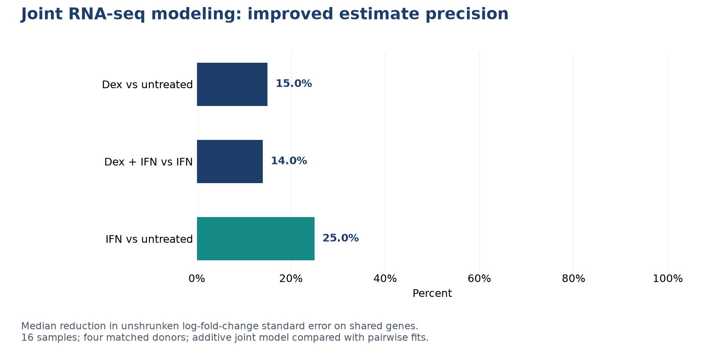

# PyDESeq2 Rapid Template

**Project by Giacomo Albergo** | Independent portfolio project | October 2026

A reproducible differential-expression workflow that improves statistical precision by modeling all four experimental conditions jointly while preserving donor pairing.

**Technology:** Python, PyDESeq2, pandas, RNA-seq, statistical inference

## What this demonstrates

- Reanalyzed 16 public PBMC RNA-seq samples from four matched healthy donors with a joint donor-plus-condition design.
- Applied a common expression filter, negative-binomial modeling, empirical-Bayes fold-change shrinkage and exact contrast/coefficient handling.
- Reported ordinary Wald results alongside separate large-effect tests, with BH false-discovery adjustment.
- Compared standard errors against pairwise fits and checked effect direction separately for all four donors.

## Evaluation

| Contrast | Large-effect FDR hits | Matching direction in all four donors | Median SE reduction vs pairwise |
| --- | ---: | ---: | ---: |
| Dex vs untreated | 213 | 213 | 15.0% |
| Dex + IFN vs IFN | 220 | 219 | 14.0% |
| IFN vs untreated | 983 | 982 | 25.0% |

The joint model retains 15,285 genes and increases residual degrees of freedom from 3 to 9. The large-effect test evaluates the null |log2 fold change| <= 1 with BH adjustment within each contrast. These counts differ from post-filtering a zero-effect p-value by a shrunken effect estimate. Standard-error comparisons use genes shared with the earlier pairwise fits.

The [aggregate metrics](results/metrics.json) contain the values behind this figure. The findings describe the stated dataset, split and evaluation protocol.

## Scope and limitations

- Four donors limit population generalization; these are exploratory reanalysis results, not validated biomarkers.
- The joint model assumes additive donor and condition effects and does not estimate donor-by-treatment interactions.
- Donor direction agreement reuses these same samples and is descriptive, not independent replication.
- More discoveries are not a measure of accuracy.

## Portfolio access

This repository shares the project overview, methodology, aggregate results and figures. The implementation, training/inference code, model artifacts and full development history are maintained in a separate private repository. Access for a technical review can be discussed through [my GitHub profile](https://github.com/ZioJack99).

See [data and method sources](DATA_SOURCES.md) and [rights and attribution](RIGHTS.md). This is a portfolio showcase, not an open-source software release.
